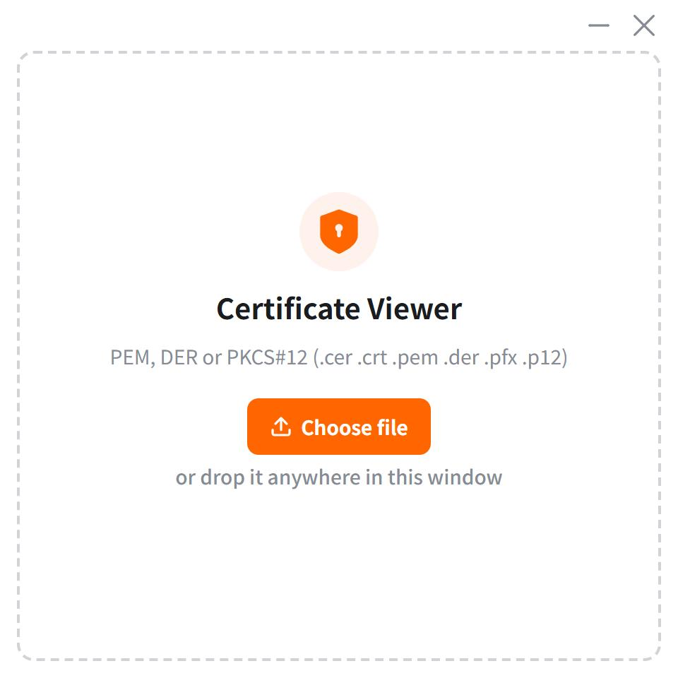
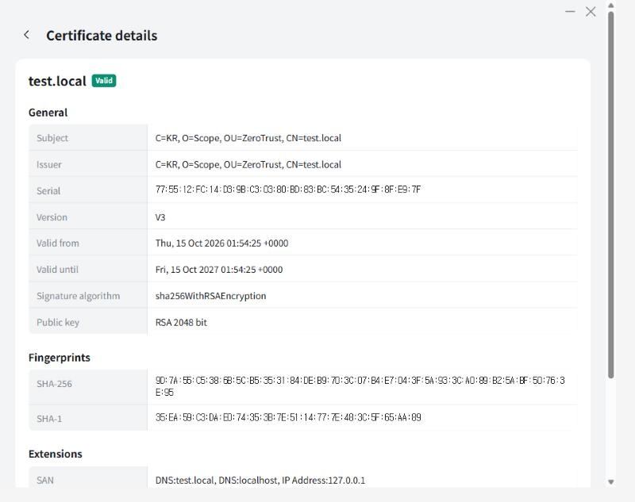

<div align="center">

**English** · [한국어](docs/readme/README_ko.md)


# Certificate Viewer

### View certificate files on Windows without installing them

[](https://tauri.app)
[](https://react.dev)
[](https://github.com/rusticata/x509-parser)
[](https://seed-design.io)
[](../../releases)
[](LICENSE)

**[Releases](../../releases) · [Issues](../../issues)**

[Why](#why) · [Supported formats](#supported-formats) · [What it shows](#what-it-shows) · [Install](#install) · [Development](#development) · [Stack](#stack)

</div>

> [!NOTE]
> Nothing is added to the Windows certificate store. Files are parsed locally and the app makes no network requests.

<div align="center">

<br />


&nbsp;&nbsp;


<br /><br />

</div>

---

Double-clicking a `.cer` or `.pfx` file on Windows opens the certificate **import** wizard. You only wanted to read it, but Windows first asks which store to install it into, and the fingerprint or SAN is a few tabs away.

Certificate Viewer shows the details as soon as you drop the file onto the window. Since nothing is installed, you can freely open certificates from other people, expired ones, or ones you just want to inspect and throw away.

## Why

| | |
|---|---|
| 🔒 **No install** | Nothing is added to the certificate store. It only reads. |
| 🖱️ **Drag and drop** | Drop a file anywhere on the window. A file picker is there too. |
| 🔑 **PKCS#12** | Password-protected `.pfx` / `.p12` files open after you enter the password. |
| 📑 **Whole chain** | A PEM with several certificates is shown as tabs. |
| 🦀 **Rust parser** | Parsing is done by `x509-parser`. Files never leave your machine. |

## Supported formats

| Extension | Format | Notes |
|---|---|---|
| `.pem` `.crt` `.cer` | PEM | Multiple `CERTIFICATE` blocks allowed |
| `.der` `.cer` | DER | Single certificate |
| `.pfx` `.p12` | PKCS#12 | Password prompt; every certificate in the archive is shown |

## What it shows

| Section | Fields |
|---|---|
| General | Subject · Issuer · Serial · Version · Validity period · Signature algorithm · Public key |
| Fingerprints | SHA-256 · SHA-1 |
| Extensions | SAN · Key Usage · Extended Key Usage · Full extension list (critical flagged) |
| Status | Valid / expired badge · CA badge |

## Install

Windows 10 or later, 64-bit. Pick a language; the UI language is fixed per build.

| | Download |
|---|---|
| 🇺🇸 English | [CertificateViewer-en-x64-setup.exe](../../releases/latest/download/CertificateViewer-en-x64-setup.exe) |
| 🇰🇷 한국어 | [CertificateViewer-ko-x64-setup.exe](../../releases/latest/download/CertificateViewer-ko-x64-setup.exe) |

All versions are on the [Releases](../../releases) page. Or build it yourself as described below.

## Development

```bash
yarn install
yarn tauri dev
```

Requirements: [Node.js](https://nodejs.org) 20+, [Yarn](https://classic.yarnpkg.com) 1.x, [Rust](https://rustup.rs) 1.85+, [Tauri 2 prerequisites](https://tauri.app/start/prerequisites/)

## Build

```bash
yarn build:en   # English UI
yarn build:ko   # Korean UI
```

Installers are written to `src-tauri/target/release/bundle/nsis/`. The language is chosen at build time: `build:ko` runs Vite with `--mode ko`, which loads `.env.ko` and bundles only the Korean strings from `src/strings.ts`.

Pushing a `v*` tag builds both installers on GitHub Actions and attaches them to a release.

## Stack

| Layer | Used |
|---|---|
| Shell | [Tauri 2](https://tauri.app) |
| UI | [React 19](https://react.dev) + [Seed Design](https://seed-design.io) |
| Certificate parsing | [x509-parser](https://github.com/rusticata/x509-parser) · [p12-keystore](https://crates.io/crates/p12-keystore) |
| Bundler | [Vite](https://vite.dev) |

## License

[MIT](LICENSE) © 2026 kbk

Bundled third-party notices (Seed Design, Apache-2.0) are in [THIRD_PARTY_NOTICES.md](THIRD_PARTY_NOTICES.md).
